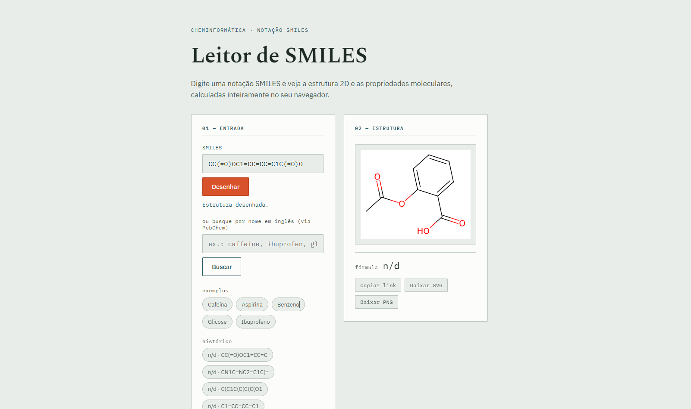

# Leitor de SMILES

[](https://github.com/lucasBalmantcoder/SMILES2D/actions/workflows/ci.yml)



Visualizador de estruturas moleculares completo, leve e instalável: converte uma notação SMILES em uma estrutura 2D e 3D, calculando propriedades físico-químicas e avaliando parâmetros de biodisponibilidade oral.

Todo o processamento estrutural 2D e cálculos de descritores acontecem no navegador via [RDKit.js](https://www.rdkit.org/) (WebAssembly) — não há backend próprio nem envio de dados a servidores.

---

## Funcionalidades

### 🧪 Química & Farmacologia
- **Desenho 2D de Alta Qualidade**: Renderização vetorial precisa de estruturas moleculares a partir de qualquer SMILES válido.
- **Interatividade 2D Completa**:
  - **Zoom e Pan Fluido**: Aumente (+) ou diminua (−) o zoom, utilize a roda do mouse (*scroll wheel*) ou dê duplo clique para redefinir. Arraste (*drag & drop*) a molécula pelo canvas livremente.
  - **Numeração de Átomos (*Atom Indices*)**: Botão de alternância rápida (`Nº`) para exibir a numeração canônica de cada átomo no esqueleto 2D (ideal para identificação de centros quirais e atribuição espectroscópica). Os índices são preservados na exportação SVG/PNG.
  - **Modo Tela Cheia**: Expansão com um clique (`⛶`) para projeções em aulas, palestras e conferências.
- **Cálculo de Propriedades Físico-Químicas**: Massa molar, fórmula molecular (notação de Hill), número de anéis, área de superfície polar (TPSA), doadores e aceptores de hidrogênio (HBD/HBA) e ligações rotacionáveis.
- **Destaque de Grupos Funcionais & Subestruturas (SMARTS)**:
  - **Paleta de Acesso Rápido**: Destaque instantâneo de funções orgânicas essenciais com um clique: Álcool, Carboxila, Amina, Amida, Éster, Carbonila, Anel Aromático, Halogênios, Éter e Nitro.
  - **Busca por SMARTS Customizado**: Digite qualquer padrão SMARTS para pesquisar motivos estruturais específicos (ex.: `[OX2H]`, `c1ccccc1`, `[NX3]`).
  - **Identificação Precisa**: Localização dos átomos e ligações via RDKit (`get_substruct_matches`) com contorno fluorescente colorido no SVG 2D e contagem de ocorrências.
- **LogP (Crippen)**: Estimativa de coeficiente de partição octanol-água para avaliação de lipofilicidade.
- **Solubilidade Aquosa (ESOL Delaney)**: Estimativa de $\text{Log S}$ pelo modelo preditivo de Delaney (2004) a partir de descritores topológicos.
- **Regra dos 5 de Lipinski (*Drug-likeness*)**: Avaliação automática dos 4 critérios de biodisponibilidade para fármacos orais (Massa $\le 500\text{ Da}$, $\text{LogP} \le 5$, $\text{HBD} \le 5$, $\text{HBA} \le 10$) com badges informativos de conformidade e tooltips detalhando eventuais violações.
- **Radar de Biodisponibilidade (*SwissADME style*)**: Gráfico vetorial em teia de aranha (radar com 6 eixos) avaliando se a molécula situa-se dentro da zona ideal para absorção oral:
  - **LIPO** (Lipofilicidade): $-0.7 \le \text{XLOGP3} \le +5.0$
  - **SIZE** (Tamanho): $150 \le \text{MW} \le 500\text{ g/mol}$
  - **POLAR** (Polaridade): $20 \le \text{TPSA} \le 130\text{ \AA}^2$
  - **INSOLU** (Insolubilidade): $-6.0 \le \text{LogS} \le 0.0$
  - **INSATU** (Insaturação): $0.25 \le \text{Fsp}^3 \le 1.0$
  - **FLEX** (Flexibilidade): $0 \le \text{RotBonds} \le 9$
- **Busca por Nome Comum**: Resolução automática de nomes em inglês (ex.: *caffeine*, *ibuprofen*, *aspirin*) para SMILES, nome IUPAC e InChIKey via API pública do [PubChem](https://pubchem.ncbi.nlm.nih.gov/docs/pug-rest).

### 🕶️ Visualização 3D Interativa
- **Conformação Tridimensional**: Integração com a base conformacional do PubChem e renderização acelerada por WebGL via [3Dmol.js](https://3dmol.csb.pitt.edu/).
- **4 Estilos de Representação**:
  - **Bastonetes (*stick*)**: Modelo clássico de esferas e ligações.
  - **Esferas (*sphere/CPK*)**: Preenchimento espacial por raio de Van der Waals.
  - **Linhas (*wireframe*)**: Esqueleto minimalista de ligações.
  - **Superfície (*surface*)**: Superfície de Van der Waals translúcida sobreposta à estrutura.
- **Controles de Câmera e Animação**: Rotação automática contínua (*spin*) com alternância rápida e botão de centralização de câmera (*reset zoom*).
- **Tema Sincronizado**: O fundo do visualizador 3D adapta-se dinamicamente entre os modos claro e escuro.

### 📱 PWA (Progressive Web App) & Modo 100% Offline
- **Instalável**: Funciona como aplicativo nativo no Windows, macOS, Linux, Android e iOS com janela dedicada e ícone próprio na área de trabalho/tela inicial.
- **Cache Inteligente**: O Service Worker (`sw.js`) armazena em cache o binário WebAssembly (`RDKit_minimal.wasm`), scripts e estilos após o primeiro carregamento.
- **Uso Offline**: A renderização 2D e o cálculo de todas as propriedades físico-químicas continuam operacionais mesmo sem conexão com a internet (ideal para laboratórios e salas de aula).

### 💾 Exportação & Compartilhamento
- **Exportação Multiformato**:
  - **MDL Molfile (`.mol` V2000)**: Compatível com ChemDraw, Avogadro, PyMOL e MarvinSketch.
  - **Vetorial (SVG)**: Para artigos científicos e apresentações sem perda de qualidade.
  - **Imagem Rasterizada (PNG 2x)**: Exportação com fundo branco em alta resolução.
- **Links Compartilháveis**: A URL reflete a molécula consultada em tempo real (`?smiles=...`).
- **Histórico Local**: Armazena as últimas moléculas consultadas em `localStorage` com chips de acesso rápido.

---

## Estrutura do projeto

```
index.html            Estrutura semântica da página e marcação da aplicação
style.css             Identidade visual editorial, tipografia e temas claro/escuro
manifest.webmanifest  Manifesto W3C com metadados para instalação PWA
sw.js                 Service Worker com estratégias de cache e operação offline
icon.svg / .png       Ícones vetoriais e bitmaps de alta resolução (192px e 512px)
js/app.js             Ponto de entrada: estado global, eventos e coordenação dos módulos
js/dom.js             Mapeamento centralizado de referências do DOM e atualizações de tela
js/molecule.js        Interação com o RDKit.js (parsing, fórmula, Molfile e descritores)
js/radar.js           Cálculo de ESOL e geração vetorial do Radar de Biodisponibilidade
js/substructure.js    Busca e destaque de grupos funcionais e subestruturas (SMARTS)
js/viewer3d.js        Resolução de SDF no PubChem e manipulação do 3Dmol.js
js/pubchem.js         Consulta de compostos e metadados na API PUG REST do PubChem
js/export.js          Exportação de arquivos (SVG, PNG, MOL), links e clipboard
js/history.js         Gerenciamento do histórico recente persistido em localStorage
js/theme.js           Alternância entre temas claro/escuro com suporte a listeners
js/utils.js           Funções utilitárias puras (formatação química, Lipinski, arredondamento)
test/                 Suíte de testes automatizados unitários
```

A aplicação adota **módulos ES nativos** (`<script type="module">`). Não há etapa de compilação ou empacotamento (*bundler*) obrigatória para execução do frontend.

---

## Executar localmente

Por usar WebAssembly e Service Workers, o navegador exige que os arquivos sejam servidos via protocolo HTTP (`localhost`) ou HTTPS (e não via `file:///` direto do disco).

Basta iniciar qualquer servidor estático local:

```bash
# Com Python 3:
python -m http.server 8000

# Ou com Node.js:
npx serve .
```

Em seguida, acesse no navegador: `http://localhost:8000`

---

## Testes automatizados

O projeto utiliza o **test runner nativo do Node.js** (`node --test`), garantindo execução rápida sem dependências externas pesadas:

```bash
npm test        # Executa os 21 testes unitários (node --test)
npm run lint    # Executa a verificação de código via ESLint
```

Todos os testes são validados automaticamente a cada push ou pull request via **GitHub Actions** (CI).

---

## Licença

Distribuído sob a licença MIT — veja o arquivo [LICENSE](LICENSE) para mais detalhes.
